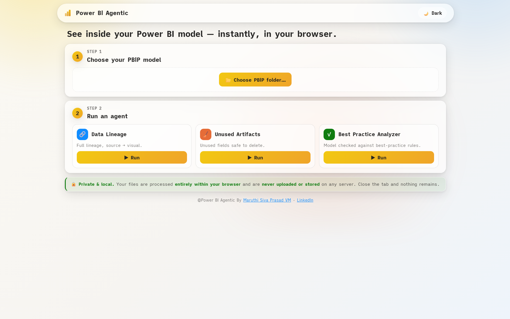
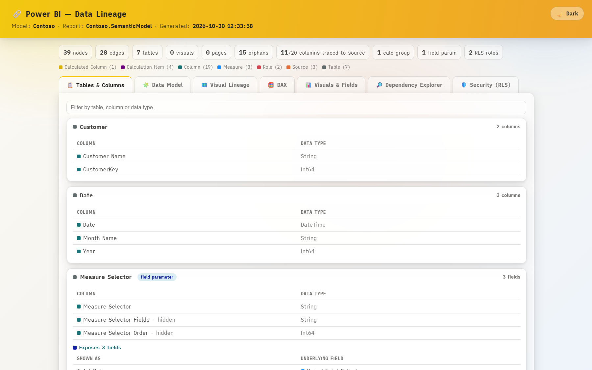
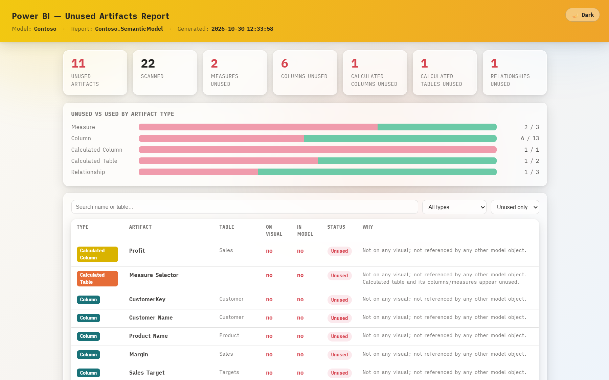
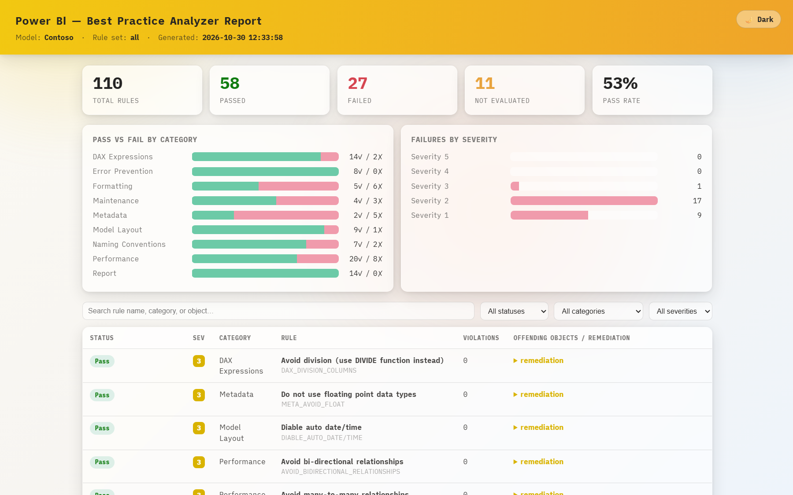

# 🔗 Power BI Agentic

**Understand any Power BI model in your browser — no install, nothing uploaded.**

## 👉 Open the app: **https://maruthisivaprasadvm.github.io/PowerBI-Agentic/**

Pick your Power BI project and get instant, shareable reports on your model's **lineage**,
**unused fields**, and **best‑practice issues**. Everything runs inside your own browser —
your data never leaves your computer.

---

## How to use it — 3 steps

1. **Open the app** → [maruthisivaprasadvm.github.io/PowerBI-Agentic](https://maruthisivaprasadvm.github.io/PowerBI-Agentic/) *(Chrome or Edge work best).*
2. **Choose your model** → click **📂 Choose PBIP folder…** and select your **Power BI Project (`.pbip`)** folder — or drag‑and‑drop a `.zip` of it.
3. **Run an agent** → click **Run** on any of the three. The report opens in a new tab; download or share it.

> 💡 No `.pbip` yet? In **Power BI Desktop → File → Save as → Power BI Project (.pbip)**.
> The first run downloads a small runtime (~10 MB, one time); after that it's instant.

---

## What you get

| Agent | What it tells you |
|---|---|
| 🔗 **Data Lineage** | How everything connects — source → table → column → measure → visual → page. Plus the **data model** (relationships & cross‑filter), a **DAX** browser, and security roles (RLS). |
| 🧹 **Unused Artifacts** | Measures, columns, tables and relationships that **nothing uses** — your safe‑to‑delete list. |
| ✓ **Best Practice Analyzer** | Your model graded against industry **best‑practice rules** — naming, DAX, relationships, formatting, performance. |

Each report is a **single, self‑contained HTML file** you can download and share.

---

## 🔒 Your data stays private

**Nothing is uploaded.** Your Power BI files are read and analysed **entirely inside your browser**.
There is no server and no network call with your data — close the tab and nothing remains.

---

## Screenshots

**The app** — pick a project and run an agent:



**🔗 Data Lineage**



**🧹 Unused Artifacts**



**✓ Best Practice Analyzer**



---

## Good to know

- **Supported input:** Power BI **Projects (`.pbip` / TMDL)** — a folder or a `.zip`.
- **Not supported:** binary **`.pbix`** files — a browser can't read them. Save as `.pbip` first (one‑time, in Power BI Desktop).
- **Best experience:** Chrome or Edge (best folder picker). Firefox also reads folders; on Safari, zip the project and choose the `.zip`.

---

## Run it on your own computer (optional)

You only need **Git**, **Python 3**, and a browser — it's a pure static site (no build, no server, no Node).

```bash
git clone https://github.com/maruthisivaprasadvm/PowerBI-Agentic.git
cd PowerBI-Agentic
python -m http.server 8777    # then open http://127.0.0.1:8777
```

On Windows you can also just run `tools\serve_web.bat`. (A static server is required — opening
`index.html` directly as a `file://` won't work.)

---

Made by **[Maruthi Siva Prasad VM](https://www.cloudbiexpert.com/)** · [LinkedIn](https://www.linkedin.com/in/maruthi-siva-prasad/) — licensed **MIT**.
